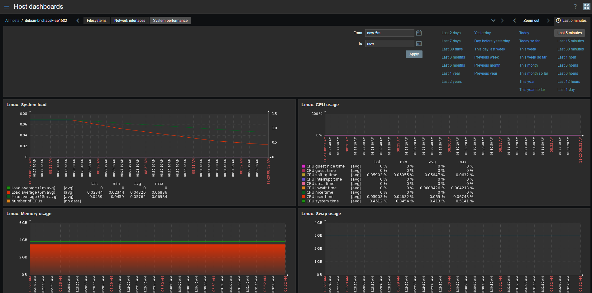

# OSY – Zabbix Agent 2 (8.0) na Debianu 13 s automatickou registrací

Virtuální stroj s Debianem 13 spuštěný pomocí Vagrantu. Zabbix Agent 2 verze 8.0 LTS se na něj nainstaluje a nakonfiguruje automaticky přes provisioning ve `Vagrantfile`. Agent se sám zaregistruje na Zabbix server `enceladus.pfsense.cz`.

## Obsah repozitáře

| Soubor | Popis |
|---|---|
| `Vagrantfile` | Debian 13 (box `bento/debian-13`, VirtualBox), dva shell provisionery |
| `install-zabbix8-agent2.sh` | Instalace Zabbix Agent 2 z oficiálního repozitáře Zabbix 8.0 pro Debian 13 |
| `configure-zabbix8-agent2.sh` | Konfigurace agenta a restart služby |
| `Images/` | Snímky obrazovky z Zabbixu (registrace a příchozí data) |

## Postup práce

### 1. Instalace (`install-zabbix8-agent2.sh`)
- Aktualizuje seznam balíčků a doinstaluje `wget`, `ca-certificates` a `openssl`.
- Stáhne balíček `zabbix-release_latest+debian13_all.deb` z `repo.zabbix.com/zabbix/8.0/` a nainstaluje ho. Tím se přidá oficiální repozitář Zabbix 8.0 pro Debian 13.
- Nainstaluje `zabbix-agent2` a povolí jeho spouštění při startu systému.
- Skript je opakovatelný: pokud už běží agent 8.0, instalaci přeskočí.

### 2. Konfigurace (`configure-zabbix8-agent2.sh`)
V `/etc/zabbix/zabbix_agent2.conf` nastaví:

- `Server=enceladus.pfsense.cz`
- `ServerActive=enceladus.pfsense.cz`
- `HostMetadata=SPOS`
- `Hostname=debian-brichacek-<náhodných 6 hex znaků>`

Náhodná část názvu se vygeneruje jen jednou a uloží do `/etc/zabbix/unique_id`. Název hosta proto zůstane stejný po restartu VM i po opakovaném spuštění provisioningu. Skript také nastaví systémový hostname a opraví `/etc/hosts`, potom agenta restartuje.

Automatickou registraci zahajuje aktivní spojení agenta (`ServerActive`). Server podle `HostMetadata=SPOS` přiřadí hostu skupinu, štítek a šablonu pro monitoring Linuxu agentem 2.

### 3. Vagrantfile
Obsahuje box s Debianem 13 a dva `shell` provisionery ve správném pořadí: nejdřív instalace, potom konfigurace.

## Spuštění

Požadavky: VirtualBox a Vagrant, přístup k internetu a k serveru `enceladus.pfsense.cz`.

```bash
vagrant up                # vytvoří VM a spustí oba provisionery
vagrant provision         # opakované spuštění provisioningu na běžícím VM
```

## Ověření výsledku

Ve virtuálním stroji (`vagrant ssh`):

```bash
zabbix_agent2 -V                         # verze 8.0.x
systemctl status zabbix-agent2           # active (running)
hostname                                 # debian-brichacek-xxxxxx
sudo journalctl -u zabbix-agent2 --no-pager | tail
```

Průběh provisioningu skončil hláškou:
`Zabbix agent2 bezi. Hostname: debian-brichacek-ae1582, Server/ServerActive: enceladus.pfsense.cz, HostMetadata: SPOS`
(nainstalován balíček `zabbix-agent2 2:8.0.0-1+debian13`).

V Zabbixu na `enceladus.pfsense.cz`:

1. V **Data collection → Hosts** najít host `debian-brichacek-ae1582`.
2. Zkontrolovat, že má přiřazenou skupinu, štítek a šablonu pro Linux agent 2.
3. V **Monitoring → Latest data** ověřit, že z hosta přicházejí aktuální data.

### Snímky obrazovky




## Řešení problémů

- Dostupnost serveru: `ping enceladus.pfsense.cz`
- Konfigurace: `grep -E '^(Server|ServerActive|Hostname|HostMetadata)=' /etc/zabbix/zabbix_agent2.conf`
- Stav služby a log: `systemctl status zabbix-agent2`, `journalctl -u zabbix-agent2`
